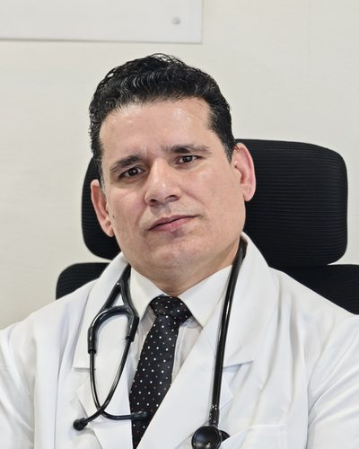

# Dr. Mohd Maqbool Sohil

**Director of Interventional Cardiology, Paras Hospitals, Srinagar**

MBBS · MD (Internal Medicine), PGIMER Chandigarh · DM (Cardiology) · FSCAI

Dr. Mohd Maqbool Sohil is an interventional cardiologist and Director of Interventional Cardiology at Paras Hospitals, Srinagar, Jammu and Kashmir, India. His practice covers complex and high-risk indicated PCI (CHIP), rotational atherectomy (rotablation), and IVUS-guided coronary intervention.

## Website and curriculum vitae

- **Professional website:** [drmaqboolsohil.deed.page](https://drmaqboolsohil.deed.page/)
- **CV (PDF) on the website:** [Dr. Mohd Maqbool Sohil — curriculum vitae](https://drmaqboolsohil.deed.page/Dr-Mohd-Maqbool-Sohil-CV.pdf)
- **CV (PDF) in this repository:** [Dr-Mohd-Maqbool-Sohil-CV.pdf](site/Dr-Mohd-Maqbool-Sohil-CV.pdf)
- **ORCID:** [0009-0000-6983-5215](https://orcid.org/0009-0000-6983-5215)
- **Facebook (procedure videos and posts):** [facebook.com/mohd.m.sohil](https://www.facebook.com/mohd.m.sohil)
- **LinkedIn:** [linkedin.com/in/mohd-maqbool-sohil-5261a49a](https://www.linkedin.com/in/mohd-maqbool-sohil-5261a49a)

## Contact and registration

- **Email:** [drsohailpgimer@gmail.com](mailto:drsohailpgimer@gmail.com)
- **Hospital:** Paras Hospitals, Srinagar, Kashmir
- **Languages:** English, Urdu, and Hindi
- **Registration:** Jammu & Kashmir Medical Council (JKMC), Reg. No. 8699 (1 August 2005). DM Cardiology (2014) is registered in the Indian Medical Register (National Medical Commission).

## Experience

Twelve years in interventional cardiology, after training in internal medicine at PGIMER Chandigarh and in cardiology at SKIMS Srinagar.

- About **10,000** cardiovascular interventions, including ~9,000 coronary angioplasties and ~1,000 non-coronary cardiovascular interventions
- About **20,000** coronary angiographies
- About **800** cardiac rhythm devices implanted: single- and dual-chamber pacemakers, CRT-P, CRT-D, and ICDs
- **70–100** rotational atherectomy procedures per year; proctor for Boston Scientific in rotational atherectomy
- **IVUS** guidance in 80–90% of coronary and peripheral interventions
- About **200** procedures per month at present, including approximately 150 coronary angiographies and 60–100 angioplasties
- Radial-first practice: about **90%** of coronary angiographies and interventions via the radial artery, including distal (dorsal) radial access
- Primary PCI: approximately **12–15** per month, with other emergency coronary interventions and IABP insertion

### Firsts in Jammu & Kashmir

- First interventional cardiologist in Jammu & Kashmir to establish intravascular ultrasound (IVUS) and rotational atherectomy in the private sector.
- First cardiologist in Jammu & Kashmir to start medical tourism in interventional cardiology.

## Areas of expertise

**Complex coronary intervention**

- Complex high-risk indicated PCI (CHIP), including interventions in cardiogenic shock
- Rotational atherectomy, including as a proctor for Boston Scientific
- Left main and bifurcation lesions, calcified lesions (including calcified bifurcations with depressed LV systolic function), and diffuse disease
- Coronary chronic total occlusion (CTO) intervention
- Primary PCI and other emergency coronary intervention

**Imaging and access**

- Intravascular ultrasound (IVUS)-guided PCI
- Transradial and distal radial access

**Peripheral, structural, and device work**

- Peripheral angiography and angioplasty, including complex lesions and chronic total occlusions; carotid and aortic interventions
- Structural heart intervention: PDA, ASD, and VSD device closure
- Pacemaker, CRT, and ICD implantation

## Appointments

**Director, Interventional Cardiology** — April 2023 to present  
Paras Hospitals, Srinagar, Jammu & Kashmir

- Leads interventional cardiology at a 250-bed hospital with a 23-bed cardiac CCU.
- Cath lab facilities include GE laboratories with StentBoost/AI, HD IVUS with ICE and peripheral IVUS probes, FFR/DFR, a rotational atherectomy system, two IABPs, a power injector, and GE echocardiography.

**Head of Unit / Director / Senior Interventional Cardiologist**  
Metro Heart Institute, Faridabad (Delhi NCR)

**Senior Consultant, Interventional Cardiology** — 7.5 years  
Narayana Multispeciality Hospital, Ahmedabad (Narayana Health)

- Coronary, peripheral, structural, and device practice in one of India’s largest networks of cardiac centres.

## Education and fellowship

- **DM Cardiology** — Sher-i-Kashmir Institute of Medical Sciences (SKIMS), Srinagar. Three-year post-doctoral programme. Passed August 2014; awarded 11 October 2014.
- **MD Internal Medicine** — Postgraduate Institute of Medical Education and Research (PGIMER), Chandigarh. Three-year postgraduate programme. Passed 30 June 2009; awarded 30 November 2009.
- **MBBS** — Government Medical College Jammu, University of Jammu. Passed 8 June 2004; awarded 22 June 2005.
- **FSCAI (USA)** — Fellow of the Society for Cardiovascular Angiography and Interventions, June 2021.

## Selected publications

Vancouver style, most recent first. The CV lists these papers together with two case reports and a published abstract.

1. **Sohil MM**, Masood I, Goyal D, Rashid H. Single centre experience of rotablation-assisted left main percutaneous coronary intervention. *Am Heart J Plus.* 2025 Nov 20;61:100678. [DOI](https://doi.org/10.1016/j.ahjo.2025.100678) · [PubMed 41377036](https://pubmed.ncbi.nlm.nih.gov/41377036/) · [PMC12689183](https://pmc.ncbi.nlm.nih.gov/articles/PMC12689183/)
2. Masood I, Goyal D, Rashid H, **Sohil M**. Interplay of cardiometabolic biomarkers and demographics in asymptomatic young adults. *J Clin Prev Cardiol.* 2025;14(4):102-6. [DOI](https://doi.org/10.4103/jcpc.jcpc_59_25)
3. Masood I, **Sohil MM**. Making rotational atherectomy in acute ST-elevation myocardial infarction safer. *J Indian Coll Cardiol.* Published online 2025 Aug 13. [DOI](https://doi.org/10.4103/jicc.jicc_93_24)
4. **Sohil MM**, Showkat HI, Anwar S. Rotablator utilization in managing complex calcified coronary lesions: a study of immediate and follow-up outcomes from an Indian medical center. *Iran Heart J.* 2025;26(1):16-26.
5. **Sohil MM**, Showkat HI, Iqbal K, Anwar S, Banday M, Nisar S. Efficacy and safety of intracoronary transplantation of peripheral blood-derived mononuclear cells (PBMNCs) autologous stem cells in patients with acute myocardial infarction: a prospective pilot study from North India (ITPASC study). *Eur J Cardiovasc Med.* 2024;14(5):467-74.
6. Gupta H, Showkat HI, Aslam N, Tandon R, Wander GS, Gupta S, Anwar S, **Sohil MM**. Chronology of cardiac dysfunction after permanent pacemaker implantation: an observational 2-year prospective study in North India. *Int J Arrhythm.* 2021;22:11. [DOI](https://doi.org/10.1186/s42444-021-00040-0)

## Teaching and presentations

- Proctor for Boston Scientific in rotational atherectomy, and for rotational atherectomy and complex and high-risk coronary interventions.
- Complex high-risk PCI broadcast live to the international virtual conference HEAL Conclave.
- Challenging cases and complex high-risk PCI presented at national and international conferences.

## Memberships

- Fellow, Society for Cardiovascular Angiography and Interventions (SCAI), since 2021
- Life Member, Cardiological Society of India (CSI)
- Life Member, Indian College of Cardiology (ICC)

---

Jammu & Kashmir Medical Council Reg. No. 8699 · [Professional website](https://drmaqboolsohil.deed.page/) · [Download CV (PDF)](https://drmaqboolsohil.deed.page/Dr-Mohd-Maqbool-Sohil-CV.pdf)
